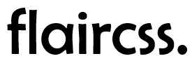

# Minimal CSS Framework

-   minimalistic
-   customizable at runtime (css variables)
-   heavily inspired by pico, bulma and bootstrap

> also this is a work in progress and experimental

# Theming

Set the brand colors (any CSS color, e.g. hex). Everything else — dark mode, hover shades,
neutrals and readable text colors — is derived in OKLCH:

```css
:root {
    --flair-primary: #216dc4;
    --flair-secondary: #bca78f;
}
```

Optional color tuning:

| Variable                           | Default | Effect                                        |
| ---------------------------------- | ------- | --------------------------------------------- |
| `--flair-dark-lightness-pivot`     | `1.15`  | dark-mode lightness = pivot − light lightness |
| `--flair-shade-step`               | `0.12`  | OKLCH lightness step for `-darkened`          |
| `--flair-tint-step`                | `25%`   | amount of white/black mixed into `-lightened` |
| `--flair-contrast-color-threshold` | `0.6`   | fills lighter than this get black text        |

Status colors: `--flair-danger-color`, `--flair-success-color`, `--flair-warning-color`.

Requires an evergreen browser with `light-dark()` and relative color syntax
(Chrome 123+, Firefox 128+, Safari 18+).

# Demo

[Demo](https://damukles.github.io/flair-css/test.html)

# Known Issues

### Navbar

-   sticky header moves content when opening burger while scrolled to top
-   burger and burger menu are quite simple

# License

Licensed under the [MIT License](LICENSE)
